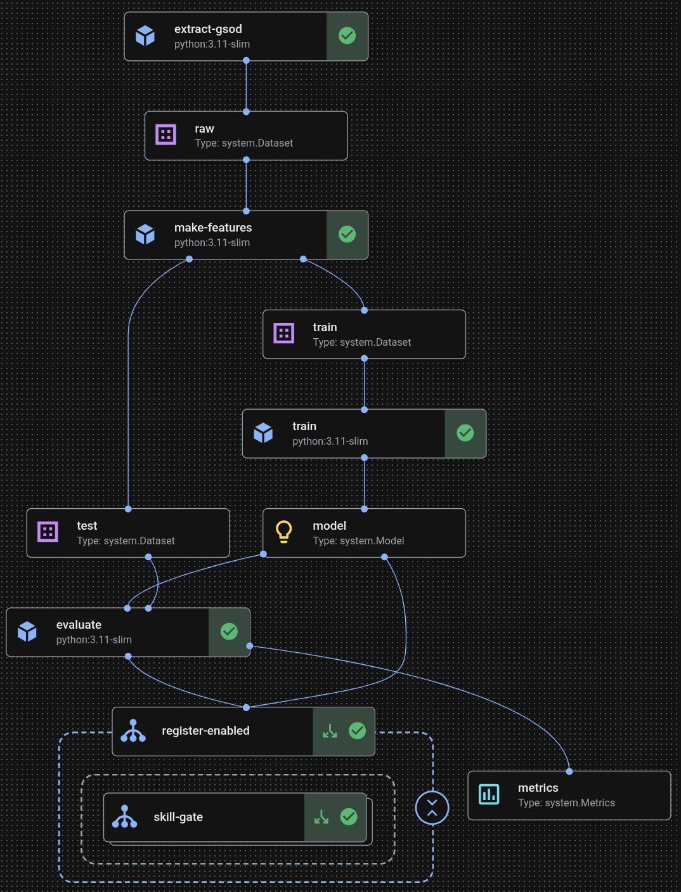

# Task: ML on GCP with GEAP Pipelines + Kubeflow

**Goal:** Build a Kubeflow (KFP v2) pipeline that trains a next-day max-temperature model for Houston (IAH) from NOAA GSOD. Run it on your laptop first, then on **Gemini Enterprise Agent Platform (GEAP) Pipelines**, the service formerly called Vertex AI Pipelines. Finish with the model in the GEAP Model Registry.

**Then operate it ([Phase 5](#phase-5-operate-it-with-airflow-and-mlflow)):** an Airflow 3.4 + MLflow stack runs the model every day: it waits for new observations, validates them, scores yesterday's forecast, monitors rolling skill, rolls back a degraded model automatically, and issues tomorrow's forecast. A weekly DAG retrains, versions every candidate, and promotes it only if it beats both persistence and the current production model. Runbook: [docs/OPERATIONS.md](docs/OPERATIONS.md).

**Project:** `wx-ml-pipeline-0` (its own GCP project) · **Region:** `us-central1` · **Account:** 98python@gmail.com

All scripts read the project from `WX_PROJECT` (default `wx-ml-pipeline-0`). For interactive `gcloud` work on this project, use the `wx-ml` configuration so your default config stays untouched:

```bash
export CLOUDSDK_ACTIVE_CONFIG_NAME=wx-ml   # this shell only
```

## How the pieces fit

| Layer | What it is here | Notes |
|---|---|---|
| Kubeflow Pipelines SDK (`kfp` 2.18) | You write the DAG in Python and compile it to IR YAML | The YAML runs the same way on kfp local, GEAP, or an OSS KFP cluster on GKE |
| GEAP Pipelines | Serverless KFP backend: no cluster to run | Every step runs as its own container on a managed VM |
| `google-cloud-aiplatform` (2.x) | SDK for submitting jobs and using the registry | The Python package name didn't change with the GEAP rename |
| BigQuery public data | `bigquery-public-data.noaa_gsod.gsod*` | Station USAF 722430 / WBAN 12960 |
| GEAP Model Registry | Versioned model plus serving container | Registered but not deployed, so nothing costs money while idle |

```
extract_gsod ─► make_features ─► train ─► evaluate ─► [register?] ─► [skill > threshold?] ─► register_model
   (BQ)          lags, split      HGB      RMSE vs                                            Model Registry
                 train <2024      sklearn  persistence
```

<a href="docs/images/geap-run-graph.png"></a>

*Run graph of the first GEAP run (2026-11-02). Every step succeeded, and with skill 0.185 above the 0.05 threshold, both the `register-enabled` and `skill-gate` conditions passed. Click the image to open it at full resolution, where you can zoom in or download it.*

## Files

| File | Purpose |
|---|---|
| `pipeline.py` | Five components and the pipeline. Running it compiles `wx_tmax_pipeline.yaml` |
| `run_local.py` | Phase 1: run with `kfp local` (each step gets its own venv) |
| `setup.sh` | Phase 2: APIs, bucket, `kfp-runner` service account, IAM |
| `run_geap.py` | Phase 3: submit to GEAP Pipelines |
| `wx_tmax_pipeline.yaml` | Compiled IR. Read through it, because this file is the actual contract |
| `wxml/` | Phase 5: shared library for the daily operations (data, features, registry, monitoring) |
| `airflow/dags/wx_daily.py` | Phase 5: daily wait, validate, verify, monitor, rollback, forecast |
| `airflow/dags/wx_retrain.py` | Phase 5: weekly champion/challenger retrain and promotion gate |
| `airflow/docker-compose.yaml` | Phase 5: Airflow 3.4 (LocalExecutor) + Postgres + MLflow 3.18 |
| `scripts/registry_cli.py` | Phase 5: model versions, manual promote and rollback |
| `scripts/validate_ghcnh.py` | Phase 5: compare GHCNh-derived daily values with GSOD for the overlapping days |
| `scripts/drill_bad_model.py` | Phase 5: promote a broken model to exercise automatic rollback |
| `tests/` | Phase 5: feature parity with `make_features`, idempotency, validation, rollback |
| `docs/OPERATIONS.md` | Phase 5: runbook for scheduling, backfills, recovery and rollback |

## Phase 0: Environment (Ubuntu 26.04)

```bash
python3 -m venv ~/venvs/kfp && source ~/venvs/kfp/bin/activate
pip install "kfp==2.18.0" google-cloud-aiplatform
python pipeline.py            # -> wx_tmax_pipeline.yaml
```
**Check:** open the YAML and find `root.dag.tasks`, the `executorLabel`s, the `condition-` blocks from `dsl.If`, and `resourceCpuLimit` on `train`.

## Phase 1: Local run (no cost)

```bash
python run_local.py                 # synthetic AR(1) weather, offline
python run_local.py --source bq     # real GSOD (needs: gcloud auth application-default login)
```
**Check:**
- `./local_outputs/.../evaluate/metrics` shows `rmse_F`, `rmse_persistence_F` and `skill`.
- Synthetic data gives skill ≈ 0.05, since lag-1 persistence is already a strong baseline. With real data, write down the skill you get. It determines whether the gate opens in Phase 3.
- Find where `model.joblib` was written. On GEAP, that same path becomes a `gs://` URI.

## Phase 2: GCP setup

```bash
bash setup.sh
```
**Check:**
- The script prints the available `sklearn-cpu.*` serving images. If `1-5` isn't listed, change `serving_image` and the `SKLEARN` pin in `pipeline.py` so they match. A mismatched sklearn version is the classic unpickle failure at serving time.
- Explain why the job runs as `kfp-runner` instead of the default compute SA, and what `iam.serviceAccountUser` grants your own user.

## Phase 3: Run on GEAP Pipelines

```bash
python pipeline.py && python run_geap.py
```
**Check:**
1. In the console's Pipelines view, open the run graph and each step's logs. Each step should show its own `pip install` and then the same output you saw locally.
2. Look at `gs://wx-ml-pipeline-0-kfp/pipeline_root/...` and match each artifact to its component output.
3. Re-run without changes. Every step should come back **cached** and finish in seconds. Then run `--no-cache` and compare.
4. Run `--param learning_rate=0.03 --param max_iter=600`. Only `train` and the steps after it should re-execute. Explain why, using the cache key: component spec plus inputs.
5. If the gate opened, find `wx-tmax-iah` in the Model Registry and check its `skill_x1000` label. If it didn't open, raise or lower `skill_threshold` until you see both branches.

## Phase 4: Stretch goals (pick any)

| # | Exercise | What it teaches |
|---|---|---|
| A | Swap `register_model` for GCPC `ModelUploadOp` plus a `dsl.importer` of `UnmanagedContainerModel` | Prebuilt Google components and typed artifacts |
| B | Wrap `train` in `create_custom_training_job_from_component` (GCPC) with `machine_type="n1-standard-8"` or a GPU | Running a step as a GEAP Custom Job and controlling the hardware |
| C | Add a `dsl.ParallelFor` over `learning_rate` values, then a step that picks the best model | Fan-out and fan-in with `dsl.Collected` |
| D | Batch prediction from the registered model on the 2025 test set (`Model.batch_predict`) | Serving without paying for an endpoint |
| E | `job.create_schedule(cron="0 12 * * *", ...)` for a daily retrain | GEAP pipeline schedules |
| F | Run the **same YAML** on OSS Kubeflow Pipelines (kind or GKE + kubeflow/manifests) | What managed GEAP saves you: MinIO, Argo, metadata DB |
| G | Replace sklearn with a small PyTorch MLP on a GPU step | Closer to your H100/DDP background |

## Phase 5: Operate it with Airflow and MLflow

The KFP pipeline answers "can we train a good model?". Phase 5 answers "can we run it every day and trust the output?".

```
wx_daily (06:00 UTC, one run per observation day D)
  wait_for_obs ─► validate_obs ─► verify ─► check_skill ─► skill_branch ─┬─► rollback ─┐
  sensor: NCEI    range and       score the  rolling skill  degraded?     └─► skill_ok ─┴─► forecast D+1
  published D?    completeness    forecast   of @production                                with @production
                  checks          made for D (30 days)

wx_retrain (Sundays 07:00 UTC)
  refresh_history ─► train_candidate ─► register ─► promotion_gate ─┬─► promote  (@previous <- old, @production <- new)
                     candidate AND       new MLflow                  └─► reject
                     @production scored  model version
                     on the same holdout
```

| Concern | How it is handled |
|---|---|
| Scheduling | `CronDataIntervalTimetable`: each run owns one day's interval and processes only that day, never "today" |
| Backfills | `airflow backfill create ...`; every output is keyed by date and written atomically, so reprocessing overwrites rather than duplicates |
| Recovery | Retries with exponential backoff for transient errors; immediate failure (no retries) for bad data, so no forecast is built from it; immediate failure when the source is missing (404) or more than 10 days stale; failure alerts to `data/alerts/` and an optional webhook |
| Versioning | Every candidate is an MLflow model version with metrics, training window, Airflow run id and gate decision |
| Monitoring | Each forecast is verified against the observation once it arrives; rolling skill vs persistence for the production version only, out-of-sample days only |
| Rollback | Rolling skill < 0 over at least 14 days moves `@production` back to `@previous` before the next forecast; idempotent, and suppressed in backfills unless explicitly allowed |
| Training/serving skew | `wxml/features.py` must match `make_features` in `pipeline.py`; `tests/test_feature_parity.py` runs the real KFP component and fails on any difference |

**Data source.** NCEI retired GSOD (the dataset behind the BigQuery table used in Phases 1-3) on 2025-08-29, so it has no data after that date. The operations layer computes the same daily values from **GHCN-hourly** (GHCNh), the hourly dataset that replaced ISD, which GSOD itself was computed from. Station `USW00012960` (IAH), UTC days, converted to GSOD's units, so the model features are unchanged. `scripts/validate_ghcnh.py` compares the result with GSOD for the days both cover: means agree almost exactly, while daily max/min come out about 2 F narrower because they are extremes of hourly readings, so the operational model predicts the highest hourly reading rather than the official maximum (details in [docs/OPERATIONS.md](docs/OPERATIONS.md#data-source)). `WX_SOURCE=synthetic` gives offline, deterministic data for development and drills.

The Phase 1-3 KFP pipeline still reads GSOD from BigQuery for 2010-2025, which is fine for that training exercise, but it cannot be run on current data.

```bash
cd airflow
cp .env.example .env && sed -i "s/^AIRFLOW_UID=.*/AIRFLOW_UID=$(id -u)/" .env
docker compose up -d --build                     # Airflow http://localhost:8080 (airflow/airflow), MLflow http://localhost:5000
docker compose exec airflow-scheduler airflow dags unpause wx_retrain   # first model
docker compose exec airflow-scheduler airflow dags unpause wx_daily     # daily runs + catchup
```

Tests (no services needed; the parity test also needs `kfp`):

```bash
pip install -r tests/requirements.txt
pytest
```

Next step, not built yet: have `wx_retrain` submit the KFP pipeline to GEAP (`RunPipelineJobOperator` in the Google provider) instead of training inside Airflow, so the same compiled pipeline is the only training path.

## Cost and cleanup

- A pipeline run costs about $0.03 plus a few minutes of small-VM time per step. BigQuery scans for one station over 16 years are tiny.
- Endpoints bill by the hour. If you deploy one in a stretch goal, undeploy it the same day.
- Cleanup: `gcloud storage rm -r gs://wx-ml-pipeline-0-kfp/pipeline_root/**`, then delete models with `gcloud ai models list/delete --region=us-central1`. To remove everything at once: `gcloud projects delete wx-ml-pipeline-0`.

## GEAP vs OSS Kubeflow: things that differ

- GEAP requires a `pipeline_root`. OSS KFP defaults to MinIO.
- GEAP has no PVCs or recursive components. Storage is GCS, through `/gcs/` FUSE paths.
- On GEAP, caching is per-run (`enable_caching`) and per-task (`.set_caching_options`).
