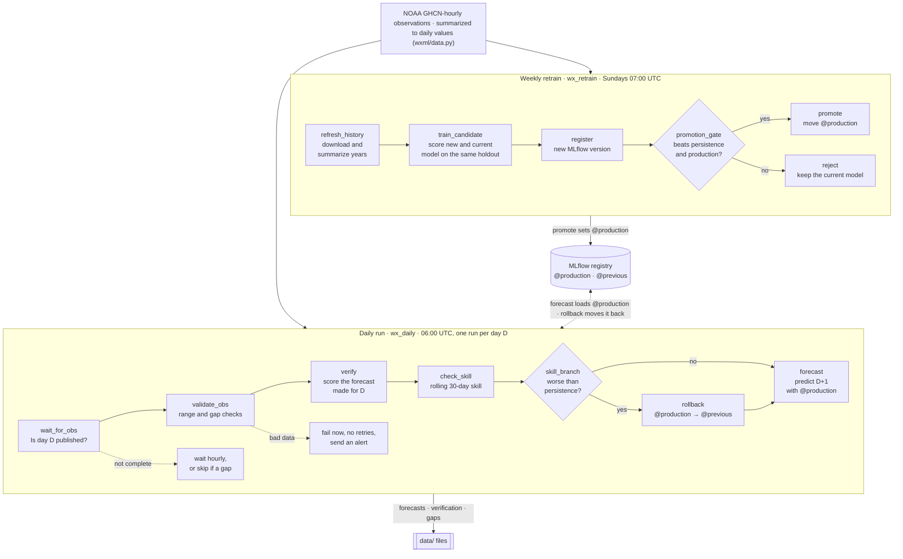

# wx-ml-pipeline: a next-day temperature forecast, run as a production ML system

A model that forecasts tomorrow's high temperature at Houston Intercontinental (IAH), and the system that runs it unattended every day. **Airflow 3.4** schedules the work and recovers from failures; **MLflow 3.18** versions every model and decides which one is live. Each day the system waits for NOAA's new observations, validates them, scores yesterday's forecast against what actually happened, monitors the live model's skill, rolls it back automatically if it degrades, and issues tomorrow's forecast. Every week it retrains and promotes the new model only if it beats both a simple baseline and the current production model.

The project started as a Kubeflow training pipeline on Google Cloud; [Project history](#project-history) describes how it got here.

## How it works



At any step, network or MLflow errors retry with exponential backoff, and a missing or stale data source fails at once and sends an alert.

| Concern | How it is handled |
|---|---|
| Scheduling | `CronDataIntervalTimetable`: each run owns one day's data interval and processes only that day, never "today", so catchup and backfills give the same result the run would have given on the day |
| Backfills | `airflow backfill create ...`; every output is keyed by date and written atomically (temp file + rename), so reprocessing overwrites rather than duplicates |
| Recovery | Retries with backoff for transient errors; immediate failure without retries for bad data, so no forecast is built from it; failure alerts to `data/alerts/` and an optional webhook |
| Late data vs gaps | A day not yet published waits (sensor, reschedule mode). A day still incomplete when later days are complete is a gap in the source: it is recorded in `data/gaps/` and skipped, so it never blocks later days |
| Dead source | A missing file (404) or a feed more than 10 days stale fails immediately instead of looking like "not published yet" |
| Versioning | Every candidate is an MLflow model version with metrics, training window, Airflow run id and the gate's decision |
| Monitoring | Each forecast is verified once its day is observed; rolling skill vs persistence for the production version only, on out-of-sample days only |
| Rollback | Rolling skill < 0 over at least 14 days moves `@production` back to `@previous` before the next forecast; idempotent, and suppressed in backfills unless explicitly allowed |
| Lineage | Each forecast file records the model version, its training cutoff, the Airflow run id and the input features |
| Training/serving skew | `wxml/features.py` must match `make_features` in `pipeline.py`; `tests/test_feature_parity.py` runs the real KFP component and fails on any difference |

The full runbook (scheduling semantics, backfill options, recovery procedures, rollback commands and failure drills) is in [docs/OPERATIONS.md](docs/OPERATIONS.md).

### Data source

Observations come from NOAA's **GHCN-hourly** (GHCNh) dataset, station `USW00012960` (IAH), about 3 days behind real time. `wxml/data.py` summarizes the hourly reports into UTC days and converts them to GSOD's units (°F, mb, knots, inches), so the model's features are the same ones the original pipeline used.

GSOD, the daily dataset the project started with, was retired by NOAA on 2025-08-29. GHCNh replaced ISD, the hourly dataset GSOD was computed from. `scripts/validate_ghcnh.py` compares the two for the 239 days in 2025 that both cover: daily means agree almost exactly (correlation 1.000 for temperature, dew point and pressure), while daily max/min come out about 2 °F narrower, because they are extremes of hourly readings rather than the station's reported extremes. The operational model therefore predicts the highest hourly reading at IAH, and training and forecasting use the same definition. Details are in [docs/OPERATIONS.md](docs/OPERATIONS.md#data-source).

`WX_SOURCE=synthetic` gives deterministic offline data for development and drills.

## Quick start

Requires Docker with Compose. Tested on Ubuntu 26.04 under WSL2.

```bash
cd airflow
cp .env.example .env && sed -i "s/^AIRFLOW_UID=.*/AIRFLOW_UID=$(id -u)/" .env
docker compose up -d --build        # Airflow http://localhost:8080 (airflow/airflow), MLflow http://localhost:5000
docker compose exec airflow-scheduler python /opt/wx/scripts/validate_ghcnh.py    # optional: check the data source
docker compose exec airflow-scheduler airflow dags unpause wx_retrain   # trains and promotes the first model
docker compose exec airflow-scheduler airflow dags unpause wx_daily     # daily runs, catching up from 2026-11-01
docker compose exec airflow-scheduler python /opt/wx/scripts/registry_cli.py status
```

Stop it with `docker compose down` (keeps all data); `docker compose down -v` also deletes the Airflow database and the MLflow registry.

Tests need no running services; the parity test also needs `kfp`:

```bash
pip install -r tests/requirements.txt
pytest
```

## Repository layout

| Path | Purpose |
|---|---|
| `airflow/dags/wx_daily.py` | Daily DAG: wait, validate, verify, monitor, roll back, forecast |
| `airflow/dags/wx_retrain.py` | Weekly DAG: champion/challenger retrain and promotion gate |
| `airflow/docker-compose.yaml`, `Dockerfile`, `mlflow.Dockerfile` | Airflow 3.4 (LocalExecutor) + Postgres + MLflow 3.18 |
| `wxml/` | The logic the DAGs call, testable without Airflow: `data` (GHCNh, summaries, validation), `features`, `model`, `registry` (versions, promote, rollback), `monitor` (rolling skill), `store` (atomic outputs), `ops` (task logic), `alerts` |
| `scripts/registry_cli.py` | List model versions; promote or roll back by hand |
| `scripts/validate_ghcnh.py` | Compare GHCNh-derived daily values with GSOD |
| `scripts/drill_bad_model.py` | Put a broken model into production to exercise automatic rollback |
| `tests/` | Feature parity with the KFP component, GHCNh summaries, idempotency, validation, gaps, rollback |
| `docs/OPERATIONS.md` | Runbook |
| `pipeline.py`, `run_local.py`, `run_geap.py`, `setup.sh`, `wx_tmax_pipeline.yaml` | The original Kubeflow training pipeline on GEAP (see [history](#project-history)) |

## Project history

The project began as an exercise in training a model on Google Cloud and grew into a system for running one.

| Phase | Date (2026) | What was built | What it answered |
|---|---|---|---|
| 0–1 | Oct | Kubeflow (KFP v2) pipeline, run locally with `kfp local` on synthetic and then real GSOD data from BigQuery | Can the model beat persistence? |
| 2–3 | Oct–Nov 2 | The same compiled pipeline on GEAP Pipelines (formerly Vertex AI Pipelines), with a skill gate and the GEAP Model Registry | Can it train and register on managed cloud infrastructure? |
| 4 | — | Stretch-goal exercises (listed below) | Optional extensions of the GEAP pipeline |
| 5 | Nov 19–21 | Airflow + MLflow operations layer | Can it run every day, unattended, and be trusted? |

### Phases 0–3: a Kubeflow training pipeline on GEAP

`pipeline.py` defines five KFP components: extract GSOD from BigQuery, build lag features, train a scikit-learn gradient-boosting model, evaluate it against persistence, and register it only if its skill clears a threshold. The pipeline compiles to `wx_tmax_pipeline.yaml`, which runs unchanged on `kfp local`, on GEAP Pipelines, or on an open-source KFP cluster.

```
extract_gsod ─► make_features ─► train ─► evaluate ─► [register?] ─► [skill > threshold?] ─► register_model
   (BQ)          lags, split      HGB      RMSE vs                                            Model Registry
                 train <2024      sklearn  persistence
```

<a href="docs/images/geap-run-graph.png"></a>

*Run graph of the first GEAP run (2026-11-02). Every step succeeded, and with skill 0.185 above the 0.05 threshold, both the `register-enabled` and `skill-gate` conditions passed. Click the image to open it at full resolution.*

| Layer | What it is here | Notes |
|---|---|---|
| Kubeflow Pipelines SDK (`kfp` 2.18) | The DAG, written in Python and compiled to IR YAML | The YAML runs the same way on kfp local, GEAP, or OSS KFP on GKE |
| GEAP Pipelines | Serverless KFP backend: no cluster to run | Every step runs as its own container on a managed VM |
| `google-cloud-aiplatform` (2.x) | SDK for submitting jobs and using the registry | The package name didn't change with the GEAP rename |
| BigQuery public data | `bigquery-public-data.noaa_gsod.gsod*` | Station USAF 722430 / WBAN 12960; no data after 2025-08-29 |
| GEAP Model Registry | Versioned model plus serving container | Registered but not deployed, so nothing costs money while idle |

### Phase 5: operating the model

Training a good model once answered only half the question. Phase 5 added the parts a production system needs: a daily schedule tied to data intervals, a sensor for late data, validation, verification of every forecast, rolling skill monitoring, automatic rollback, weekly champion/challenger retraining, and a runbook with failure drills.

It was built and tested against a real Airflow 3.4 and MLflow 3.18 setup on synthetic data first, which surfaced bugs before any real data was involved:

- **Version types.** MLflow returns model version numbers as `int` from one backend and `str` from another, which would have broken the rollback comparison. All registry functions now return `str`.
- **Outage mistaken for "no model".** An MLflow outage raised the same exception class as "alias not set", so it would have been read as "no production model". Only the two not-found error codes are now treated that way; outages raise and are retried.
- **A test too weak to catch drift.** The first feature-parity test passed even when the feature code was deliberately changed, because its test gap was too short to exercise the interpolation limit. It now fails on that change.

Running it on real data then exposed problems no synthetic test could:

- **The data source had been retired.** GSOD stopped on 2025-08-29, so no 2026 file exists. The original code treated the 404 as "not published yet", and the sensor would have waited until it timed out. The system now uses GHCNh (validated against GSOD), and a missing or stale source fails at once with an alert.
- **A gap in the station record.** IAH has no usable observations for 2026-11-09 to 11-12. The sensor could not tell "late" from "never coming", so a 4-day outage would have stalled the pipeline. Gap days are now recorded and skipped; forecasts that need a gap day as an input skip too, and resume automatically 3 days after the data returns.

The first model trained on real data (2010 to 2026-08-16, 6,069 days) scored a skill of 0.119 vs persistence on its 86-day fall holdout (RMSE 3.75 °F vs 4.25 °F) and was promoted as version 1. That is not directly comparable to GEAP's 0.185, which was measured over two full years with GSOD's definition of the daily maximum; the rolling skill from daily verification is the number to watch.

**Next step, not built yet:** have `wx_retrain` submit the KFP pipeline to GEAP (`RunPipelineJobOperator` in the Airflow Google provider) instead of training inside Airflow, so the same compiled pipeline is the only training path. Its data step would also need to move from GSOD to GHCNh.

## Reproducing the GEAP training pipeline (phases 0–4)

These are the original exercise steps. The pipeline still runs, but on GSOD it covers only 2010 to August 2025.

**Project:** `wx-ml-pipeline-0` (its own GCP project) · **Region:** `us-central1` · **Account:** 98python@gmail.com

All scripts read the project from `WX_PROJECT` (default `wx-ml-pipeline-0`). For interactive `gcloud` work on this project, use the `wx-ml` configuration so your default config stays untouched:

```bash
export CLOUDSDK_ACTIVE_CONFIG_NAME=wx-ml   # this shell only
```

| File | Purpose |
|---|---|
| `pipeline.py` | Five components and the pipeline. Running it compiles `wx_tmax_pipeline.yaml` |
| `run_local.py` | Phase 1: run with `kfp local` (each step gets its own venv) |
| `setup.sh` | Phase 2: APIs, bucket, `kfp-runner` service account, IAM |
| `run_geap.py` | Phase 3: submit to GEAP Pipelines |
| `wx_tmax_pipeline.yaml` | Compiled IR. Read through it, because this file is the actual contract |

### Phase 0: Environment (Ubuntu 26.04)

```bash
python3 -m venv ~/venvs/kfp && source ~/venvs/kfp/bin/activate
pip install "kfp==2.18.0" google-cloud-aiplatform
python pipeline.py            # -> wx_tmax_pipeline.yaml
```
**Check:** open the YAML and find `root.dag.tasks`, the `executorLabel`s, the `condition-` blocks from `dsl.If`, and `resourceCpuLimit` on `train`.

### Phase 1: Local run (no cost)

```bash
python run_local.py                 # synthetic AR(1) weather, offline
python run_local.py --source bq     # real GSOD (needs: gcloud auth application-default login)
```
**Check:**
- `./local_outputs/.../evaluate/metrics` shows `rmse_F`, `rmse_persistence_F` and `skill`.
- Synthetic data gives skill ≈ 0.05, since lag-1 persistence is already a strong baseline. With real data, write down the skill you get. It determines whether the gate opens in Phase 3.
- Find where `model.joblib` was written. On GEAP, that same path becomes a `gs://` URI.

### Phase 2: GCP setup

```bash
bash setup.sh
```
**Check:**
- The script prints the available `sklearn-cpu.*` serving images. If `1-5` isn't listed, change `serving_image` and the `SKLEARN` pin in `pipeline.py` so they match. A mismatched sklearn version is the classic unpickle failure at serving time.
- Explain why the job runs as `kfp-runner` instead of the default compute SA, and what `iam.serviceAccountUser` grants your own user.

### Phase 3: Run on GEAP Pipelines

```bash
python pipeline.py && python run_geap.py
```
**Check:**
1. In the console's Pipelines view, open the run graph and each step's logs. Each step should show its own `pip install` and then the same output you saw locally.
2. Look at `gs://wx-ml-pipeline-0-kfp/pipeline_root/...` and match each artifact to its component output.
3. Re-run without changes. Every step should come back **cached** and finish in seconds. Then run `--no-cache` and compare.
4. Run `--param learning_rate=0.03 --param max_iter=600`. Only `train` and the steps after it should re-execute. Explain why, using the cache key: component spec plus inputs.
5. If the gate opened, find `wx-tmax-iah` in the Model Registry and check its `skill_x1000` label. If it didn't open, raise or lower `skill_threshold` until you see both branches.

### Phase 4: Stretch goals (pick any)

| # | Exercise | What it teaches |
|---|---|---|
| A | Swap `register_model` for GCPC `ModelUploadOp` plus a `dsl.importer` of `UnmanagedContainerModel` | Prebuilt Google components and typed artifacts |
| B | Wrap `train` in `create_custom_training_job_from_component` (GCPC) with `machine_type="n1-standard-8"` or a GPU | Running a step as a GEAP Custom Job and controlling the hardware |
| C | Add a `dsl.ParallelFor` over `learning_rate` values, then a step that picks the best model | Fan-out and fan-in with `dsl.Collected` |
| D | Batch prediction from the registered model on the 2025 test set (`Model.batch_predict`) | Serving without paying for an endpoint |
| E | `job.create_schedule(cron="0 12 * * *", ...)` for a daily retrain | GEAP pipeline schedules |
| F | Run the **same YAML** on OSS Kubeflow Pipelines (kind or GKE + kubeflow/manifests) | What managed GEAP saves you: MinIO, Argo, metadata DB |
| G | Replace sklearn with a small PyTorch MLP on a GPU step | Closer to your H100/DDP background |

### Cost and cleanup

- A pipeline run costs about $0.03 plus a few minutes of small-VM time per step. BigQuery scans for one station over 16 years are tiny.
- Endpoints bill by the hour. If you deploy one in a stretch goal, undeploy it the same day.
- Cleanup: `gcloud storage rm -r gs://wx-ml-pipeline-0-kfp/pipeline_root/**`, then delete models with `gcloud ai models list/delete --region=us-central1`. To remove everything at once: `gcloud projects delete wx-ml-pipeline-0`.

The Airflow + MLflow stack runs locally and costs nothing.

### GEAP vs OSS Kubeflow: things that differ

- GEAP requires a `pipeline_root`. OSS KFP defaults to MinIO.
- GEAP has no PVCs or recursive components. Storage is GCS, through `/gcs/` FUSE paths.
- On GEAP, caching is per-run (`enable_caching`) and per-task (`.set_caching_options`).
